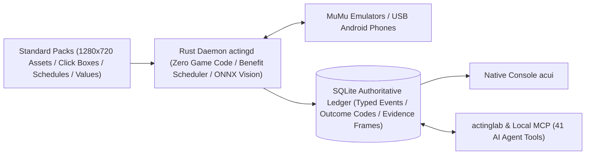

<p align="right">🌐 <b>English</b> · <a href="./README.zh-CN.md">简体中文</a></p>

<div align="center">


<h1>ActingCommand</h1>

<p><b>Local-First Multi-Game Automation, Deterministic Visual Execution & AI-Assisted Operations System</b></p>

**Chief Executive Officer & Chairman** — HS7097<br/>
**Chief Technology Officer & Chief Architect** — Claude Opus 5.5 · GPT‑6 Astra · Claude Fable 5.2 · Claude Fable 5.1 · Claude Fable 5 · GPT‑5.5<br/>
**Board Secretary & Chief Audit Officer** — Claude Opus 5.5 · Claude Fable 5.2 · Claude Fable 5.1 · Claude Fable 5 · Claude Opus 4.8<br/>
**Principal Engineer** — GPT‑6 Astra · Claude Opus 5.5 · GPT‑5.6 Sol · GPT‑5.5<br/>
**Director of Fleet Operations** — GPT‑6 Astra<br/>
**Fleet Supervisor** — GPT‑5.6 Sol Daybreak · DeepSeek V4.1 Flash 1017<br/>
**Business Operations Lead** — Gemini‑4 Carbon · Gemini‑4 Argon

</div>

> [!IMPORTANT]
> **Active `0.12` Convergence Preview Series (Road to `v1.00`)**: Interfaces, configuration schemas, and pack formats are actively converging through live-device validation. Only the newest release is supported; older series receive no backported fixes.

---

**ActingCommand** is a local multi-game automation and orchestration system for Windows: everyday routine runs are **executed 100% deterministically by a resident Rust daemon on your machine (zero LLM token cost, zero network code)**, scheduling multiple Android emulators or physical phones by net benefit and resource redlines—while natively providing an authoring workshop and a local MCP server so AI agents can help author task packs, inspect the authoritative ledger, and diagnose anomalies on demand.

---

## 1. What It Can Do Today

All capabilities below are shipped and working in the latest member releases ([`Runtime v0.12.55`](https://github.com/HS7097/ActingCommand-Runtime/releases/tag/v0.12.55) · [`UI v0.12.16`](https://github.com/HS7097/ActingCommand-UI/releases/tag/v0.12.16)):

- **Unattended Local Resident Daemon (`actingd`)**
  - Runs independently in the background; closing consoles or CLI clients never interrupts active schedules, and the per-user `actingwatch` watchdog can automatically restart the daemon after crashes or reboots.
  - Native **MuMu Emulator** integration (high-speed Nemu IPC frame capture and touch input, plus automatic instance discovery and emulator start/stop via MuMuManager) alongside **USB Android handsets** (ships with official `adb 37.0.1`), with live hot-switching of touch and capture backends.
  - Strict per-instance fault isolation: a failure on one device affects only that instance; idle instances automatically have their game closed (or emulator stopped) to save memory and restarted ahead of the next scheduled run.
- **Net-Benefit & Dual-Waterline Smart Scheduling**
  - Dispatches tasks on both clock slots and live instance facts read into the ledger (such as stamina recovery timestamps or facility cooldowns).
  - Ranks business tasks dynamically by **`net benefit ÷ expected run time`**, refusing to dispatch tasks whose benefit is unknown or non-positive; resource pools enforce **stop lines** and **hard redlines** so reserves saved for banners or events are never drained.
  - Supports persistent global or per-instance pause/resume, priority offsets, resource targets, and disk-capacity gates—and **every task that did not run states an explicit reason**.
- **Hybrid Deterministic Vision + Graded Recovery Ladder**
  - Eight recognition target kinds: template matching, color, color digest, click-only, OCR, ONNX neural network, composite (2–8 targets), and value comparison, plus multi-match anchor search with masks and several scales; ONNX models load in-process on first use, OCR supports DirectML GPU acceleration, and clicks rotate naturally among central candidate points.
  - Failed scheduled runs automatically hand the instance over to a configurable **recovery ladder** (return home → restart game app → restart emulator); manual debug runs never trigger the ladder accidentally.
- **Single-Writer Authoritative Ledger & Native Console (`acui`)**
  - Every step—what was seen, where it clicked, and which registered outcome code returned—is sanitized into an append-only SQLite ledger; frames are deduplicated by content digest, expired frames are cleaned automatically, and error/Lab evidence frames are archived under `kept/`.
  - The native desktop console `acui` inspects all six ledger views live (via the Runtime) or offline (directly from the state root), displays account and watchdog status, starts/stops the Runtime, and hot-switches device backends.
- **Game-Neutral Economy Modeler (`acmodel`)**
  - Standalone offline Python 3.13 modeling and solving tool featuring LP/MILP economy optimization, exact gacha pity chains, Wilson confidence bounds, and sensitivity derivation graphs, exporting prices, redline thresholds, and task scores directly into schedule bindings.
- **Authoring Workshop & AI Agent Integration (`actinglab` + 41 Local MCP Tools)**
  - `actinglab` records `linear_steps` task packs from live screens, validates task packs and standard packs, provides everyday short inspection/control commands, and offers one-step rescue deployment and rollback.
  - `actingctl mcp-serve` exposes **41 tier-gated local tools** over stdio so AI agents can check fleet health, inspect single frames, record new packs, and trace failures safely.

---

## 2. What Is Actively Being Built

As the `0.12.z` series converges toward **`v1.00`** (ending preview), the team is actively building:

- **Full `0.12` Standard Pack Coverage Across Four Flagship Games**: **Arknights**, **Azur Lane**, **Blue Archive**, and **Girls' Frontline 2: Exilium** run continuously on the project's 5-instance testbed while full daily, progression-farming, recurring-event packs, and scheduler benefit tables are being completed.
- **Multi-Game Rotation Within a Single Device / Emulator Instance**: Moving beyond one-game-per-instance so a single phone or emulator instance can host multiple games (including Android multi-user app clones), queuing tasks by cross-game urgency in one foreground queue and cleanly stopping background apps on switch.
- **Player Control Loop in `acui` & Unified Two-Entry Tooling**: Adding visual instance setup, routine toggles, and farming goal controls to `acui`, while unifying CLI and MCP surfaces into `actinglab`—forming two clean entry points (**`acui` for everyday players, `actinglab` for developers and AI agents**).
- **Per-Game Valuation Engine Integration & Smart Agent Wake**: Connecting per-game character/gear valuation engines to automated farming targets, alongside stalled-task detection, an outcome-code quick index, and error-based wake rules that page an AI agent or user only when the recovery ladder cannot self-heal.
- **Return of the Graphical Setup Wizard (`acsetup`) & Bundled Releases**: Reintroducing one-click graphical installation/upgrades and full umbrella releases once `0.12` interfaces and ledger schemas lock for `v1.00`.

---

## 3. How It Works



1. **Strictly Neutral Core—Switch Games by Switching Packs**: The source code, contracts, configuration templates, outcome catalogs, and tests of the Runtime, UI, CLI, and MCP server contain **zero game logic or game-specific strings** (enforced by CI guard scans). Every image, click region, state transition, and value table lives inside per-game standard packs validated before admission.
2. **The Ledger Is the Single Source of Truth**: The scheduler decides what runs next from ledger facts, the console reads ledger views exclusively, and any incident can be reconstructed from the ledger and its evidence frames alone.
3. **Fail Loud**: Every operation returns a registered outcome code and deterministic exit status; invalid configuration, unexpected frame resolution (all current standard packs target `1280×720`), or missing evidence fails explicitly with preserved diagnostics rather than clicking blindly or degrading silently.
4. **Local Loopback Only**: `actingd` listens strictly on `127.0.0.1` / `[::1]` and contains no networking code: the Runtime itself sends nothing off your machine. What a connected AI agent reads through MCP goes wherever that agent sends it.
5. **Decoupled, Interface-Verified Releases**: Runtime, UI, and each standard pack release independently when changed; compatibility is verified against declared interface revisions in `BUILD-MANIFEST.json`, not by matching version strings.

---

## 4. What You Need to Do

### System Prerequisites
- **OS**: Windows (developed and tested on Windows 11; installs per user; no administrator privileges required).
- **Target Device**: **MuMu Android Emulator** configured to **`1280×720`**, or an Android phone connected via USB debugging.
- **Optional Runtimes**: ONNX Runtime + vision models under `vision\` for OCR / neural-network targets; Python 3.13 for the standalone `acmodel` economy solver.

### Choose Your Onboarding Path

- **For Everyday Players (Looking for Turnkey Daily Farming)**
  - The `0.12` series introduced a new ledger and pack format; **`0.12` standard packs are not yet publicly distributed, and the `acsetup` wizard is temporarily omitted from `0.12` UI builds**. Watch this repository for the upcoming `v1.00` milestone release when turnkey installers and standard packs reconverge.
  - *(Legacy note: Release [`v0.11.4`](https://github.com/HS7097/ActingCommand/releases) on this repository still carries the older `0.11` setup wizard and `0.11` packs for Arknights, Azur Lane, and Blue Archive as a historical reference; `0.11` is incompatible with `0.12` and is no longer maintained.)*

- **For Developers & Pack Authors (Running the Latest `0.12` Core + AI Tooling Today)**
  1. **Lay Out a `0.12` Root Once**: Download the newest `actingcommand-runtime-<sha>.zip`, `actingcommand-tools-<sha>.zip`, and `SHA256SUMS` from [`ActingCommand-Runtime` Releases](https://github.com/HS7097/ActingCommand-Runtime/releases), verify checksums, extract into `<root>\runtime\` and `<root>\tools\`, and create `<root>\actingd.config.json` from the template (see Runtime's [`INSTALL.md`](https://github.com/HS7097/ActingCommand-Runtime/blob/v0.12.55/distribution/windows/INSTALL.md) for DirectML GPU OCR, bundled `adb`, startup, and shutdown). Optionally grab `acui-windows-<sha>.zip` from [`ActingCommand-UI` Releases](https://github.com/HS7097/ActingCommand-UI/releases) for the `acui.exe` console.
  2. **Adopt Managed Updates & Watchdog**: Run `<root>\runtime\actingctl.exe install adopt` once so `actingctl install` (`release stage`, `update plan`, `update apply`, `rollback`) manages in-place updates while keeping your config and ledger intact (pass `--accept-ledger-one-way` across one-way ledger revisions). Run `<root>\runtime\actingctl.exe watchdog install --root <root>` from a non-elevated PowerShell to enable automatic crash recovery.
  3. **(Optional) Connect an AI Agent via Local MCP**: Print the stable MCP entry registration (writes no files) and add it to your agent harness (`claude` / `codex` / `antigravity` / `dsh`), then start a fresh client session:
     ```powershell
     <root>\runtime\actingctl.exe mcp-config --client claude --entry --root <root> --tier observer,operator,author
     <root>\runtime\actingctl.exe mcp-config --client codex  --entry --root <root> --tier observer,operator,author
     ```

<details>
<summary><b>Expand: MCP Permission Tiers, All 41 Tools & Agent Conventions (Runtime v0.12.55)</b></summary>

<br/>

- **Permission Tiers**: `observer` is enabled by default (reads, safe live settings, performance presets, handset binding, capability-gap logs, remedy choices, and routine health); `operator` adds device/app/schedule controls and evidence read confirmations (also required when `ac_config_set` switches touch/capture backends); `author` adds live Lab observation and pack recording.
- **Operating Conventions**: Call `ac_overview` first; long operations immediately return a restart-safe handle polled via `ac_get_run` (`wait_s`)—always query `ac_get_run` before retrying an uncertain write. Configuration file edits, catalog approvals, and Runtime restarts stay with the human operator.
- **Skill Reference**: [`skills/actingcommand/SKILL.md`](skills/actingcommand/SKILL.md) preserves recipes written against `v0.11.3`; on a `0.12` Runtime, use `<root>\runtime\actingctl.exe mcp-serve --list-tools --format markdown` as the authoritative tool and parameter reference.

| Tier | Tools |
|---|---|
| `observer` (25) | `ac_overview`, `ac_events`, `ac_material`, `ac_observe`, `ac_get_run`, `ac_diagnose`, `ac_runs`, `ac_run_evidence`, `ac_resources_list`, `ac_targets_get`, `ac_config_set`, `ac_perf_preset`, `ac_packs`, `ac_facts`, `ac_outcome_code`, `ac_devices`, `ac_device_bind`, `ac_device_unbind`, `ac_capability_gap`, `ac_remedy_set`, `ac_remedy_get`, `ac_schedule`, `ac_routine_summary`, `ac_pack_check`, `ac_catalog_check` |
| `operator` (9) | `ac_run_pack`, `ac_stop_run`, `ac_pause`, `ac_resume`, `ac_emulator`, `ac_app`, `ac_ladder_drill`, `ac_evidence_confirm_read`, `ac_targets_set` |
| `author` (7) | `ac_lab_observe`, `ac_lab_do`, `ac_record_start`, `ac_record_mark`, `ac_record_stop`, `ac_record_status`, `ac_binding_draft` |

</details>

---

## 5. Repository Map

ActingCommand is organized as a decoupled repository family combining **open-source game-neutral infrastructure** with **isolated private asset and valuation repositories**, keeping proprietary game screenshots, coordinates, and economy tables strictly separated from the neutral engine:

| Repository | Visibility | Role & Scope | Current Status |
|---|---|---|---|
| [**ActingCommand**](https://github.com/HS7097/ActingCommand) *(this repo)* | 🔓 Public | **Umbrella Portal**: Project overview, license policy, `skills/` agent manual, and cross-member milestone Releases | Docs active (bundled Release stays at legacy `v0.11.4` until `v1.00`) |
| [**ActingCommand-Runtime**](https://github.com/HS7097/ActingCommand-Runtime) | 🔓 Public | **Core Runtime**: Resident `actingd` daemon, scheduler, vision engine, SQLite ledger, `actingctl` / `actinglab` / `actingledger` / `actingwatch`, and local MCP server | Active (`v0.12` series, latest [`v0.12.55`](https://github.com/HS7097/ActingCommand-Runtime/releases/tag/v0.12.55)) |
| [**ActingCommand-UI**](https://github.com/HS7097/ActingCommand-UI) | 🔓 Public | **Desktop UI & Neutral Modeler**: Native `acui` console, `acsetup` wizard, `acforward` launcher, and game-neutral `acmodel` economy solver | Active (`v0.12` series, latest [`v0.12.16`](https://github.com/HS7097/ActingCommand-UI/releases/tag/v0.12.16)) |
| **ActingCommand-Models** | 🔒 Private | **Game Valuation & Economy Engines**: Per-game character valuation, progression calculators, and adapters hosted by `acmodel` | Active internal integration |
| **ActingCommand-Resources-Arknights** | 🔒 Private | **Arknights Standard Pack**: `1280×720` visual anchors, click boxes, task packs, and schedule value tables | `0.12` pack completion & live testing |
| **ActingCommand-Resources-AzurLane** | 🔒 Private | **Azur Lane Standard Pack**: `1280×720` visual anchors, click boxes, task packs, and schedule value tables | `0.12` pack completion & live testing |
| **ActingCommand-Resources-BlueArchive** | 🔒 Private | **Blue Archive Standard Pack**: `1280×720` visual anchors, click boxes, task packs, and schedule value tables | `0.12` pack completion & live testing |
| **ActingCommand-Resources-GirlsFrontline2** | 🔒 Private | **Girls' Frontline 2: Exilium Standard Pack**: `1280×720` visual anchors, click boxes, task packs, and schedule value tables | `0.12` pack completion & live testing |
| **ActingCommand-Resources-Nikke** | 🔒 Private | **NIKKE Resource & Economy Data**: Cost graphs, economy rules, and fixed-reference capability views | Data modeling research |
| **ActingCommand-Workflow** | 🔒 Private | **Governance & Architecture**: Cross-repo contracts, issue tracking, outcome-code audits, and multi-agent workflows | Internal daily operations |

*(Note: `bundles/` and `docs/` in this umbrella repository hold archived materials from earlier milestones for reference only and are no longer updated.)*

---

## Contributing & License

- **Feedback & Issues**: Have suggestions or run into an issue while running `0.12` or authoring packs? Open an [Issue](https://github.com/HS7097/ActingCommand/issues) in this repository or the relevant public member repository.
- **License**: This repository and ActingCommand-Runtime are released under [`AGPL-3.0-only`](LICENSE); ActingCommand-UI is `GPL-3.0-only`. No source code of other automation projects is in the project's repositories; the Arknights standard pack contains interface template images from MaaAssistantArknights (`AGPL-3.0-only`). See [`LICENSE_POLICY.md`](LICENSE_POLICY.md) and [`NOTICE.md`](NOTICE.md) for the upstream license matrix, third-party components and the compliance rules.
