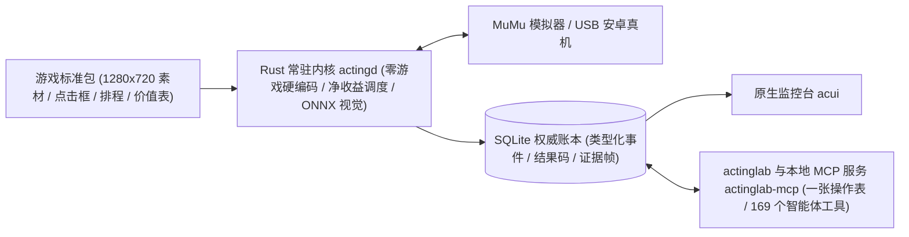

<p align="right">🌐 <a href="./README.md">English</a> · <b>简体中文</b></p>

<div align="center">


<h1>ActingCommand</h1>

<p><b>面向多款二次元手游的本地常驻自动化调度、视觉执行与智能体协同系统</b></p>

**首席执行官 兼 董事长** — HS7097<br/>
**首席技术官 兼 首席架构师** — Claude Opus 5.5 · GPT‑6 Astra · Claude Fable 5.2 · Claude Fable 5.1 · Claude Fable 5 · GPT‑5.5<br/>
**董事会秘书 兼 首席审计官** — Claude Opus 5.5 · Claude Fable 5.2 · Claude Fable 5.1 · Claude Fable 5 · Claude Opus 4.8<br/>
**首席技术工程师** — GPT‑6 Astra · Claude Opus 5.5 · GPT‑5.6 Sol · GPT‑5.5<br/>
**运维总监** — GPT‑6 Astra<br/>
**运维主管** — GPT‑6 Sol Daybreak · GPT‑5.6 Sol Daybreak · DeepSeek V4.1 Flash 1017<br/>
**业务运营组长** — Gemini‑4 Carbon · Gemini‑4 Argon

</div>

> [!IMPORTANT]
> **当前处于 `0.12` 收敛预览系列（正在迈向 `v1.00` 正式版）**：接口、配置与数据包格式仍在随实机验证快速收口；现阶段仅维护最新版本，不向旧系列回迁修复。

---

**ActingCommand** 是一套运行在 Windows 本机的多游戏自动化统筹系统：日常挂机 **100% 由本地 Rust 常驻内核确定性执行（零大模型 Token 消耗、不含任何联网代码）**，按净收益与资源红线自动管理多台安卓模拟器或真机；同时原生提供录制工坊与本地 MCP 服务，让 AI 智能体在你需要时协助制作任务包、查阅权威账本与诊断异常。

---

## 1. 我们现在能做什么

以下能力均已在当前最新发布（[`Runtime v0.12.83`](https://github.com/HS7097/ActingCommand-Runtime/releases/tag/v0.12.83) · [`UI v0.12.33`](https://github.com/HS7097/ActingCommand-UI/releases/tag/v0.12.33)）中落地可用：

- **多实例本地常驻与无人值守（`actingd`）**
  - 常驻后台进程独立运行，关闭控制台或命令行不影响后台调度；支持 `actingwatch` 用户级看门狗在崩溃或重启后自动拉起。
  - 原生对接 **MuMu 模拟器**（高速 Nemu IPC 截帧与触控、经 MuMuManager 自动发现实例与启停模拟器）及 **USB 安卓真机**（自带官方 `adb 37.0.1`），支持运行中热切换触控与截图后端。
  - 实例级严格故障隔离：单台卡死不影响其余实例；一段时间无待办任务时自动关闭游戏或停掉模拟器释放内存，下一轮任务前自动唤醒。
- **按净收益与双水位红线算账的智能调度**
  - 支持按时钟槽与实例实时事实（如从画面读出的体力回满时刻、冷却完成时刻）双重触发。
  - 业务任务按 **「单次净收益 ÷ 预计运行时长」** 动态排定优先级，净收益未知或非正的任务绝不盲派；资源池支持设置 **停止线** 与 **硬红线**，防止耗尽留作活动或抽卡的资源储备。
  - 支持全局/单实例持久化暂停与恢复、优先级偏移与磁盘容量准入；可为账号的资源池设定目标，目标的缺口计入对应任务的收益；**每一个未执行的任务都会给出具体原因**。
- **混合确定性视觉内核 + 分级自愈阶梯**
  - 内置 8 种识别目标：模板匹配、颜色、颜色摘要、仅点击、OCR、ONNX 神经网络、组合条件（2–8 项组合）与数值比对，另支持多尺度带遮罩的锚点多匹配检索；OCR 与神经网络在进程内按需加载运行，OCR 支持经 DirectML 调用 GPU 加速；点击落点在目标框中心候选点间自然轮换。
  - 例行任务失败后自动由配置化的 **恢复阶梯**（回主页 → 重启游戏应用 → 重启模拟器）接手自救，手动触发的调试运行不误触阶梯；阶梯用尽、实例被隔离等人处理或出现指定结果码的失败时，可按配置的规则唤醒已登记的智能体会话（Claude Code / Codex / DSH），并可每日定时发送汇总。
- **单写者权威账本与原生桌面监控台（`acui`）**
  - 每一步“看到了什么、点了哪里、返回什么登记结果码”均脱敏写入本地 SQLite 账本，截图按内容摘要去重存储，自动清理过期帧并将错误/录制关键帧归档至 `kept/` 目录。
  - 原生桌面监控台 `acui` 支持在线（经 Runtime）或离线（直读状态目录）查看账本六大视图、查看账号与看门狗状态、启停内核以及热切换各设备后端；主页提供「实时画面」「日常任务」「目标」三个页签，可暂停/恢复全部或单个实例的调度，并在「目标」页为账号设定目标。
- **中立游戏经济建模工具（`acmodel`）**
  - 独立离线的 Python 3.13 建模与求解器，内置 LP/MILP 经济规划、精确抽卡保底链、样本掉率置信界与灵敏度推导图谱，可导出资源价格、红线阈值与任务评分并绑定至调度配置。
- **录包工坊与 AI 智能体接口（`actinglab` + 本地 MCP 服务 `actinglab-mcp`）**
  - `actinglab` 是面向开发者与智能体的统一入口：同一张操作表（当前 169 个操作）同时驱动命令行与 MCP。支持从实机实时画面分阶段录制 `linear_steps` 任务包（含按名称挑选与滚动列表读取）、检查与试跑标准包、热放置标准包、添加实例、日常短命令巡检，以及一步完成的部署与回退（`deploy` / `rollback`）。
  - `actinglab-mcp` 通过本地 stdio 把这张操作表里的每个操作作为一个工具提供给智能体（Windows 上共 **169 个工具**，不分档），让 AI 安全协助查看健康总览、单步观察、录制新包与溯源排障；第一代的 `actingctl mcp-serve`（按权限分档的 46 个工具）在移除前继续随 Runtime 提供。

---

## 2. 我们正在实现什么

在迈向结束预览的 **`v1.00` 正式版** 之前，团队正在 `0.12.z` 系列内集中推进以下能力：

- **四款主力游戏的 `0.12` 标准包全覆盖**：**《明日方舟》《碧蓝航线》《蔚蓝档案》《少女前线2：追放》** 已在项目自有实机环境（6 个实例）持续联调，正在补齐全部日常、养成刷取、常驻活动任务包以及调度器所需的完整价值表。
- **按账号目标的缺口自动安排刷取**：将各游戏角色/装备估值模型与账号目标打通，由「缺什么」决定「刷什么」；配套扩充从游戏画面读取的库存与进度读数，让调度依据账号的实时现状做判断。
- **真机即插即用与 iOS 后端**：让安卓真机按设备原生分辨率直接接入调度（含宽于 16:9 的屏幕，无需为程序改动手机上的任何设置），并在研 iOS 设备后端。
- **单设备 / 单模拟器实例内的多游戏轮换调度**：突破“一实例绑死一款游戏”的限制，支持在同一部手机或同一个模拟器实例内挂载多款游戏（含安卓多用户应用分身），按跨游戏紧迫度单队列排队轮换前台、切走自动清理后台。
- **监控台（`acui`）玩家操控闭环**：在 `acui` 中补齐实例的可视化增删配置（目前经 `actinglab instance add` 完成）与日常开关，并让「目标」页只呈现账号级目标、日常任务以业务名展示；`actinglab` 一侧的命令行与 MCP 已统一到同一张操作表，最终形成 **「日常玩家用 `acui`、开发与智能体用 `actinglab`」** 的清晰双入口。
- **成套发布回归**：安装向导 `acsetup` 已随监控台发布件提供（从安装集离线安装）；待 `0.12` 接口与账本格式彻底定型后，恢复本伞仓的成套安装集发布与开箱即用的一键安装/升级。

---

## 3. 我们怎么做的



1. **内核绝对中立，换游戏只换包**：`Runtime`、`UI`、命令行与 MCP 的源码、契约、配置模板及测试中 **不含任何游戏逻辑或游戏信息**（无游戏名、角色名、关卡名或数值规则，由 CI 守卫自动扫描拦截）。一切游戏相关内容均封装在独立标准包内，装载前先做结构准入校验。
2. **账本是唯一事实来源**：调度器依据账本事实决定下一轮运行，监控台只读账本视图，任何异常仅凭账本与证据帧即可完整复盘。
3. **Fail Loud（绝不静默吞错）**：所有运行结果均携带统一码表登记的结果码与明确退出码；配置不合、画面无法映射到标准包的基准尺寸（标准包统一按 `1280×720` 制作，同比例更大的画面自动缩到基准）、证据缺失均立即显式报错并保留现场，绝不“瞎点蒙混”或静默降级。
4. **纯本机零外网**：`actingd` 仅监听本机回环地址（`127.0.0.1` / `[::1]`），无任何外网通信代码，Runtime 自身不向外发送任何数据；接入的智能体经 MCP 读到的内容，去向由该智能体决定。
5. **成员解耦与接口契约校验**：`Runtime`、`UI` 与各游戏标准包独立按需发版；组件间能否搭配不看表面版本号是否相同，而是由各自构建清单（`BUILD-MANIFEST.json`）声明的接口修订号严格核对。

---

## 4. 用户需要做什么

### 基础环境准备
- **操作系统**：Windows（在 Windows 11 上开发与实测；普通用户权限即可，无需管理员权限）。
- **运行设备**：**MuMu 安卓模拟器**（实例分辨率建议设为 **`1280×720`**；同比例更大的分辨率如 `1920×1080` 会自动缩到基准尺寸，录制任务包须在 `1280×720` 下进行），或开启 USB 调试的安卓真机。
- **可选组件**：使用 OCR 或神经网络识别目标需放置 ONNX Runtime 与对应视觉模型；使用 `acmodel` 经济建模工具需安装 Python 3.13。

### 按使用场景选择上手路径

- **如果你是普通玩家（希望开箱即用托管日常）**
  - 当前 `0.12` 系列启用了全新的账本与新标准包格式，**`0.12` 系列的游戏标准包暂未公开分发**；图形安装向导 `acsetup` 已随监控台发布件提供（UI `v0.12.17` 起），但它只从一份包含 Runtime、工具、监控台与各游戏标准包的「安装集」离线安装，而这份安装集尚未公开。建议先关注本仓，等待四游标准包与安装集在 `v1.00` 合拢发布后再一键安装。
  - *(历史存档说明：本仓 [Releases](https://github.com/HS7097/ActingCommand/releases) 页保留的 `v0.11.4` 附带旧版安装向导与前三款游戏的 `0.11` 标准包，仅供旧架构参考，与 `0.12` 互不兼容且不再维护。)*

- **如果你是开发者或自制包玩家（体验最新 `0.12` 内核与 AI 辅助制包）**
  1. **首次手动铺设 `0.12` 根目录**：从 [`ActingCommand-Runtime` Releases](https://github.com/HS7097/ActingCommand-Runtime/releases) 下载最新的 `actingcommand-runtime-<sha>.zip`、`actingcommand-tools-<sha>.zip` 与 `SHA256SUMS`，校验后分别解压至空目录 `<root>\runtime\` 与 `<root>\tools\`，并按模板编写 `<root>\actingd.config.json`（含 DirectML GPU OCR、自带 `adb`、启动与关闭说明详见 Runtime 仓的 [`INSTALL.md`](https://github.com/HS7097/ActingCommand-Runtime/blob/v0.12.83/distribution/windows/INSTALL.md)）；也可以用 Tools 里的 `actinglab.exe new <新根> --build <校验过的发布目录>` 一次建好全新的根、首份配置与空状态根（不启动任何进程）。如需图形监控台，从 [`ActingCommand-UI` Releases](https://github.com/HS7097/ActingCommand-UI/releases) 下载 `acui-windows-<sha>.zip`。
  2. **接管后续更新与开启看门狗**：首次铺好后，运行一次 `<root>\tools\actinglab.exe adopt` 接管该根目录；之后用 `actinglab.exe deploy <标签或提交> --dir <下载的发布目录>` 一步完成暂存、计划、停机、替换、启动与启动后检查，用 `actinglab.exe rollback` 回退到之前留存的构建（两者加 `--plan` 只出计划不执行），配置与账本原地保留；`actinglab.exe up` / `down` 启动与正式关闭 Runtime。在普通 PowerShell 中运行一次 `<root>\tools\actinglab.exe watchdog install` 即可启用崩溃自动拉起看门狗。（第一代的 `actingctl install …` 系列命令在移除前保持可用。）
  3. **（可选）注册本地 MCP 服务配合智能体使用**：运行以下命令打印 `actinglab-mcp` 的注册片段（不改写任何客户端文件），按提示添加到你的智能体客户端（支持 `claude` / `codex` / `antigravity` / `dsh`）后重开会话即可：
     ```powershell
     <root>\tools\actinglab.exe mcp config --client claude
     <root>\tools\actinglab.exe mcp config --client codex
     ```

<details>
<summary><b>展开查看：两代 MCP 服务、工具清单与智能体协作约定（Runtime v0.12.83）</b></summary>

<br/>

- **第二代服务 `actinglab-mcp`（当前主入口）**：不分档；Lab 操作表里的每个操作对应一个工具，工具名一般是 `ac_` 加命令行的词（空格与 `-` 换成 `_`，如 `emu start` 即 `ac_emu_start`），Windows 上共 169 个，以服务器的 `tools/list` 为准。会话先调 `ac_status`；超过约 25 秒的调用先返回句柄，用 `ac_run_show`（带 `wait_s`）跟进；写操作结果未明时先查 `ac_status` 或 `ac_run_show`，绝不换参数重发；启动、停止或重启 Runtime、替换配置、部署与回退只在人明确要求时才调用。
- **第一代服务 `actingctl mcp-serve`（在移除前保持可用）**：下面的档位、约定与工具表说的都是它，注册用 `<root>\runtime\actingctl.exe mcp-config --client <客户端> --entry --root <root> --tier <档位>`。
- **权限档位**：默认开启 `observer`（读取、运行中安全设置、性能预设、真机绑定、能力缺口记录、补救选择与健康统计）；`operator` 增加设备、应用、调度控制与证据已读确认（热切换实例触控/截图后端亦需此档）；`author` 增加 Lab 实机观察与录制。
- **协作约定**：会话先调 `ac_overview`；耗时操作立即返回跨重启有效的句柄，用 `ac_get_run`（带 `wait_s`）轮询，结果未明时先查句柄勿重发写操作；编辑配置文件、审批与重启 Runtime 均归人工执行。
- **工具参考说明**：本仓 [`skills/actingcommand/SKILL.md`](skills/actingcommand/SKILL.md) 保留了 `v0.11.3` 时期的操作范式参考；在 `0.12` Runtime 上，请以 `<root>\runtime\actingctl.exe mcp-serve --list-tools --format markdown` 打印的实时工具与参数表为准。

| 档位 | 工具清单 |
|---|---|
| `observer`（25 个） | `ac_overview`、`ac_events`、`ac_material`、`ac_observe`、`ac_get_run`、`ac_diagnose`、`ac_runs`、`ac_run_evidence`、`ac_resources_list`、`ac_targets_get`、`ac_config_set`、`ac_perf_preset`、`ac_packs`、`ac_facts`、`ac_outcome_code`、`ac_devices`、`ac_device_bind`、`ac_device_unbind`、`ac_capability_gap`、`ac_remedy_set`、`ac_remedy_get`、`ac_schedule`、`ac_routine_summary`、`ac_pack_check`、`ac_catalog_check` |
| `operator`（9 个） | `ac_run_pack`、`ac_stop_run`、`ac_pause`、`ac_resume`、`ac_emulator`、`ac_app`、`ac_ladder_drill`、`ac_evidence_confirm_read`、`ac_targets_set` |
| `author`（12 个） | `ac_lab_observe`、`ac_lab_do`、`ac_record_start`、`ac_record_mark`、`ac_record_stop`、`ac_record_status`、`ac_record_candidates`、`ac_record_amend`、`ac_record_step`、`ac_record_archive`、`ac_record_reopen`、`ac_binding_draft` |

</details>

---

## 5. 我们现在都有哪些仓

ActingCommand 采用「中立开源内核 + 独立私有资源与估值包」的多仓解耦架构。为确保核心程序 100% 游戏无关且严守版权边界，所有包含具体游戏画面素材、坐标区域与专有经济数据的仓库均与开源底座物理隔离：

| 仓库 | 属性 | 职责定位 | 当前状态 |
|---|---|---|---|
| [**ActingCommand**](https://github.com/HS7097/ActingCommand)（本仓） | 🔓 公开 | **项目族伞仓（门面页）**：总体说明、许可策略、`skills/` 智能体手册及跨组件整包 Releases | 文档持续更新（整包 Release 停留在旧系 `v0.11.4`，待 `v1.00` 合拢更新） |
| [**ActingCommand-Runtime**](https://github.com/HS7097/ActingCommand-Runtime) | 🔓 公开 | **核心运行时仓**：常驻进程 `actingd`、调度器、视觉识别、SQLite 账本、`actingctl` / `actinglab` / `actingledger` / `actingwatch` 及本地 MCP 服务（`actinglab-mcp`） | 活跃迭代（最新 [`v0.12.83`](https://github.com/HS7097/ActingCommand-Runtime/releases/tag/v0.12.83)） |
| [**ActingCommand-UI**](https://github.com/HS7097/ActingCommand-UI) | 🔓 公开 | **桌面端与中立建模仓**：原生监控台 `acui`、安装向导 `acsetup`、固定入口 `acforward`，以及中立经济建模工具 `acmodel` | 活跃迭代（最新 [`v0.12.33`](https://github.com/HS7097/ActingCommand-UI/releases/tag/v0.12.33)） |
| **ActingCommand-Models** | 🔒 私有 | **游戏估值与经济引擎仓**：对接 `acmodel` 宿主协议的各游戏专属角色估值、养成计算与经济适配器 | 内部研发联调中 |
| **ActingCommand-Resources-Arknights** | 🔒 私有 | **《明日方舟》标准包仓**：`1280×720` 识别锚点、点击框、任务包与排程收益数据 | `0.12` 标准包补齐与实机运行中 |
| **ActingCommand-Resources-AzurLane** | 🔒 私有 | **《碧蓝航线》标准包仓**：`1280×720` 识别锚点、点击框、任务包与排程收益数据 | `0.12` 标准包补齐与实机运行中 |
| **ActingCommand-Resources-BlueArchive** | 🔒 私有 | **《蔚蓝档案》标准包仓**：`1280×720` 识别锚点、点击框、任务包与排程收益数据 | `0.12` 标准包补齐与实机运行中 |
| **ActingCommand-Resources-GirlsFrontline2** | 🔒 私有 | **《少女前线2：追放》标准包仓**：`1280×720` 识别锚点、点击框、任务包与排程收益数据 | `0.12` 标准包补齐与实机运行中 |
| **ActingCommand-Resources-Nikke** | 🔒 私有 | **《胜利女神：NIKKE》资源数据仓**：消耗图谱、经济规则与固定参考能力视图 | 数据建模预研中 |
| **ActingCommand-Workflow** | 🔒 私有 | **工程治理与架构契约仓**：跨仓架构契约、任务单流转、结果码审计与多智能体协作规范 | 内部日常运转 |

*(注：本伞仓下的 `bundles/` 与 `docs/` 仅保留早期归档参考资料，不再随 `0.12` 更新。)*

---

## 参与反馈与开源许可

- **问题与建议**：如果你有更好的想法，或在使用与自制包过程中遇到任何问题，欢迎在本仓或对应的公开成员仓提交 [Issue](https://github.com/HS7097/ActingCommand/issues)。
- **开源许可**：本仓与 ActingCommand-Runtime 遵循 [`AGPL-3.0-only`](LICENSE) 许可证，ActingCommand-UI 为 `GPL-3.0-only`。项目各仓内没有使用其他自动化项目的源码；《明日方舟》标准包内含取自 MaaAssistantArknights 的界面模板图（`AGPL-3.0-only`）。上游许可矩阵、第三方组件与合规规则详见 [`LICENSE_POLICY.md`](LICENSE_POLICY.md) 与 [`NOTICE.md`](NOTICE.md)。
